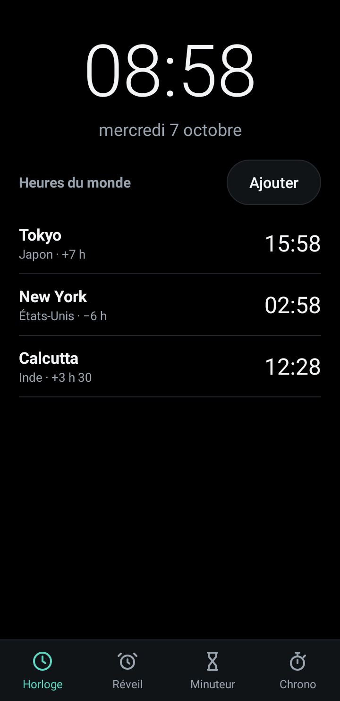
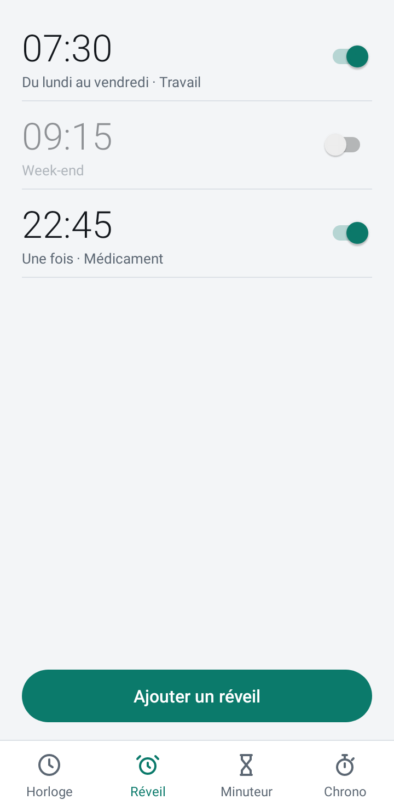
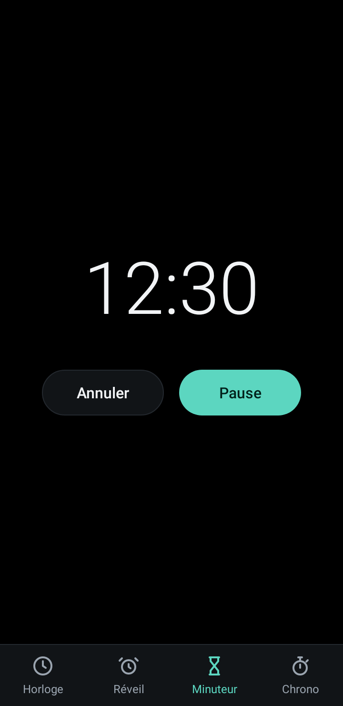
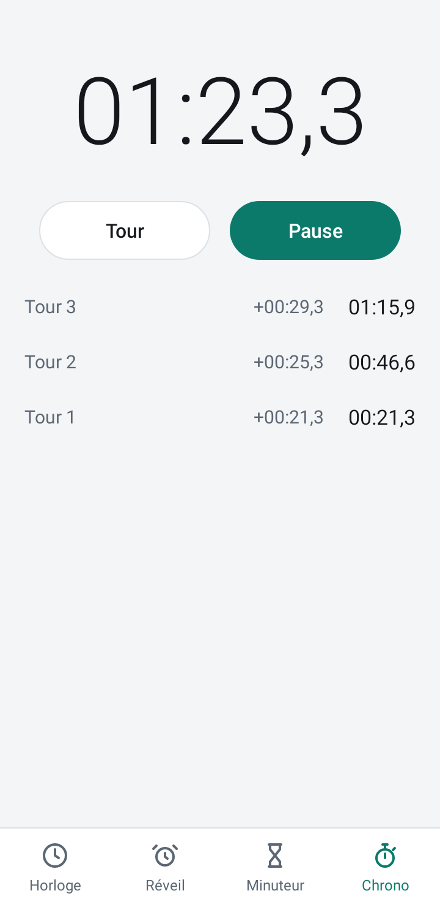
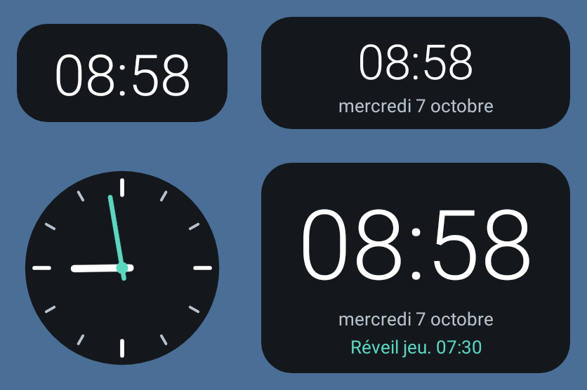

# Horloge

Horloge complète pour Android, en français, pensée pour consommer le moins
possible : quand l'appli est fermée, rien ne tourne. Pas de compte, pas de
publicité, pas d'accès à Internet.

<p>
  
  
  
  
</p>

<p>
  
</p>

## Ce que fait l'appli

- **Horloge** : heure et date, avec les heures du monde (une centaine de
  villes, recherche sans accents). Un appui sur l'heure affiche les secondes.
- **Réveil** : plusieurs alarmes, jours de répétition, nom, vibreur. Écran de
  sonnerie par-dessus l'écran verrouillé, avec « Arrêter » et « Répéter dans
  10 min ».
- **Minuteur** : sonne à la fin, même appli fermée.
- **Chrono** : au dixième de seconde, avec tours.
- **Quatre widgets** : numérique, numérique avec date, analogique, heure avec
  prochain réveil.

## Pourquoi elle consomme si peu

- **Aucun service en arrière-plan.** Le seul service de l'appli existe
  pendant qu'une sonnerie retentit, dix minutes au plus.
- **Les widgets ne réveillent jamais l'appli.** Ils utilisent les horloges
  du système (`TextClock`, `AnalogClock`) : c'est l'écran d'accueil qui fait
  avancer l'heure. Leur période de mise à jour est à zéro.
- **Alarmes et minuteur sont confiés à Android** (`AlarmManager`), qui
  relance l'appli seulement au moment de sonner.
- **Chrono et minuteur ne mémorisent que des instants.** L'affichage n'est
  rafraîchi que lorsque l'onglet est visible.
- **Interface plate** : pas d'animation, d'ombre ni de transparence, et un
  fond noir en thème sombre (pixels éteints sur écran OLED).
- **Java natif, sans bibliothèque ni WebView.** L'APK pèse environ 100 Ko.

## Installation

1. Télécharger `horloge.apk` depuis la page
   [Releases](https://github.com/ManBoyx/horloge-apk/releases).
2. L'ouvrir sur le téléphone et autoriser l'installation depuis cette source.
3. Au premier réveil créé, accepter les notifications : elles servent à
   afficher l'écran de sonnerie.

Android 8.0 ou plus récent.

### Avant de compter sur le réveil

Certains fabricants (Xiaomi, Huawei, Oppo, Samsung selon les modèles)
empêchent les applis installées à la main de se lancer seules. Si un réveil
ne sonne pas, désactiver l'optimisation de batterie pour Horloge et autoriser
son démarrage automatique dans les réglages du téléphone. Mieux vaut l'avoir
vu sonner plusieurs fois, écran éteint, avant de s'y fier pour se lever.

## Autorisations

| Autorisation | Pourquoi |
|---|---|
| Alarmes exactes | Sonner à l'heure dite |
| Notifications, plein écran | Afficher l'écran de sonnerie, même téléphone verrouillé |
| Service de premier plan | Jouer le son pendant la sonnerie |
| Démarrage du téléphone | Reprogrammer les alarmes après un redémarrage |
| Vibreur, maintien en éveil | Vibrer et jouer le son écran éteint |

Aucune autorisation Internet : l'appli ne peut rien envoyer nulle part.

## Comment c'est fait

```
app/src/main/java/fr/manboyx/horloge/
  logique/            calculs sans Android : prochaine sonnerie, minuteur,
                      chrono, formats, villes
  Depot               mémoire de l'appli
  Planificateur       programme les sonneries auprès d'Android
  MainActivity        les quatre onglets (Ecran…)
  RecepteurAlarme     reçoit l'heure de sonner
  RecepteurSysteme    redémarrage, changement d'heure ou de fuseau
  ServiceSonnerie     son, vibreur, notification
  SonnerieActivity    écran de sonnerie
  Widgets             les quatre widgets
```

Les alarmes restent programmées après un redémarrage du téléphone, y compris
avant son premier déverrouillage. Si le son d'alarme du téléphone est
introuvable, un bip intégré le remplace.

## Compiler

Il faut Java 17 et le SDK Android (plateforme 36).

```sh
export ANDROID_HOME=/chemin/vers/android-sdk
./gradlew assembleRelease
```

L'APK sort dans `app/build/outputs/apk/release/`. Sans clé de signature il
n'est pas signé ; pour le signer, créer `signature/horloge.jks` (alias
`horloge`) et `signature/cle.properties` contenant `motDePasse=...`. Ce
dossier n'est pas suivi par git.

## Tests

```sh
./gradlew testDebugUnitTest
```

Deux familles de tests :

- la logique pure (prochaine sonnerie, changements d'heure été/hiver,
  minuteur, chrono, formats, villes) ;
- l'appli elle-même dans un Android simulé (Robolectric) : démarrage, onglets,
  programmation des alarmes, sonnerie, widgets, et le fait que rien ne reste
  en attente quand un onglet est quitté.

`./tests.sh` lance la première famille seule, en quelques secondes.

Les images de cette page sont produites par les tests :

```sh
./gradlew testDebugUnitTest --tests '*CapturesTest' -Dcaptures.dir=/un/dossier
```

## Limites connues

- Les tests tournent dans un Android simulé. Le comportement sur un vrai
  téléphone (son, écran verrouillé, widgets sur l'écran d'accueil,
  consommation mesurée) dépend du modèle et de sa version d'Android.
- Un seul minuteur à la fois ; la sonnerie est celle du téléphone.
- Après un redémarrage du téléphone, un chrono en cours est remis à zéro.
